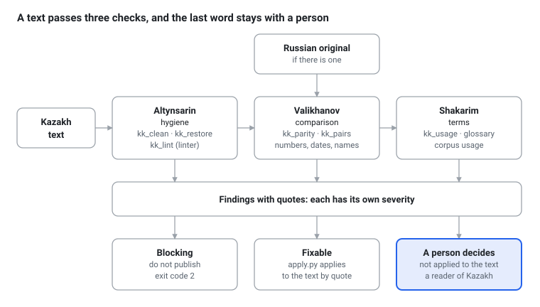
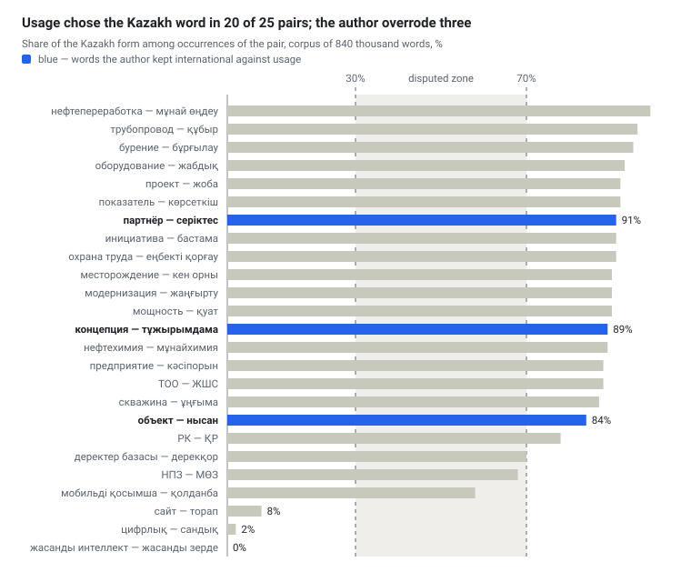

# A text that only looks correct: why Kazakh needs its own proofreader

[Русский](longread.md) · **English** · [Қазақша](longread.kk.md) · [← README](../README.en.md)

*13 October 2026*

kk-redkollegiya is a set of small programs that look for errors in a Kazakh text that the eye cannot see, and compare a translation with its Russian original. The programs correct nothing silently and write nothing for the author: cleanup leaves a journal, every finding comes with an exact quotation, and the decision stays with a person who reads Kazakh.

The set is needed because Kazakh text in the digital world has a particular affliction: a word can look flawless and still be typed with the wrong characters. The eye cannot tell them apart; a machine always can, and then search, sorting and spell-checking break. Below: what these afflictions are, how the set deals with them, and what it cannot do.

## What it is

It is an open set of programs for checking Kazakh-language texts: GPL-3.0 license, source code on GitHub, documentation in Russian, English and Kazakh. The name has two parts. «kk» is the two-letter code of the Kazakh language in the ISO 639-1 standard; it appears in locale identifiers, for example kk-KZ in Joomla language packs. «redkollegiya» is the name of the project on which the set is modeled.

The model is redkollegiya, a system for editing Russian text in Claude Code. Its idea is simple: a text goes through several separate passes, and each pass looks for its own kind of flaw: technical, semantic, stylistic. A Kazakh text needs a pass of its own for the target language, and that pass is what is built here.

The set rests on three main ideas.

- **A finding with a quotation.** The program does not rewrite the text. It reports: here is a fragment, here is what is wrong with it, here is what it can be replaced with. The change is made by a separate program, `apply.py`, by verbatim quotation, so it never touches the neighboring words.
- **Three severity levels.** A «blocking» finding means do not publish; a «fixable» one is applied to the text at once; one «at the author's discretion» is not applied at all. Anything disputed always goes to a person.
- **The last word belongs to a reader of Kazakh.** The program catches what can be measured; taste, meaning and tact remain with people.

## Why it is needed: errors the eye cannot see

Errors in a Kazakh text come in two kinds. Some the eye does not see at all: these are the troubles of letters. Others it sees but cannot catch without a long comparison: these are the troubles of translation. Let us take them in turn.

### Look-alikes: a foreign letter in a native word

In the Unicode table every character has its own number. The Cyrillic «а» (U+0430) and the Latin «a» (U+0061) are two different characters, though they are drawn identically. If the last two letters of the word «қорықса» are typed in Latin, the eye notices nothing, but search, sorting and spell-checking notice at once: to them it is a different word.

> **Background: Unicode and the homoglyph.** The name «Unicode» was meant to suggest a single universal encoding: «unique, unified, universal». The word «homoglyph» is built from the Greek *homós*, «the same», and *glyphḗ*, «carving, a carved sign»; it names a character that looks the same as another. In security the same look-alikes serve to forge addresses: a site with a Latin «a» in its name looks genuine and leads somewhere else entirely.

For Kazakh this is an especially acute danger: its own letters (ә, і, ө, ү, ұ, қ, ғ, ң, һ) have visible twins. The Latin «i» resembles the Kazakh «і», the Latin «ə» resembles «ә». The second pair is the most treacherous: both characters are called «schwa» in Unicode, yet they are different characters (U+0259 and U+04D9). In one electronic edition of Abai's «Қара сөздер», 1,085 «ә» letters turned out to be substitutes.

> **Background: schwa.** The name of the sign ə, «schwa» (in Russian «шва» or «схва»), goes back to the Hebrew name of a mark used in writing for a short, indistinct vowel or for the absence of a vowel. Today the word names both the sound and its sign.

### Legacy encodings: letters lie in the wrong places

Before Unicode came into common use, Kazakh books and newspapers were set in special fonts. Such a font drew қ or ғ in place of some other character, say a Latin letter with an accent. On the screen everything read well, but the file held foreign codes. Extract the text from such a PDF and instead of «мектеп» you get «ìåêòåï».

The set recognizes such an encoding by itself and puts the letters back. On three volumes of a novel extracted from PDF, after recoding the dictionary recognizes 77–79% of the words; before it, the text is unreadable.

> **Background: encoding.** The word «code» goes back to the Latin *codex*, «a trunk, a wooden writing tablet», later «a book, a body of laws». An encoding is a table that matches numbers to characters; old Kazakh fonts used foreign tables in their own way.

### Substitutions: a control character instead of a letter

It gets worse. When text is extracted from a PDF, some Kazakh letters turn into invisible control characters or into Latin letters. In one book there were about 760 such characters. For 602 words the correction was confirmed by the dictionary; another 154 were inferred from context. Whatever the dictionary did not confirm, the set marks as a guess and hands to a person.

### Typed without Kazakh letters

Many people type Kazakh on a Russian keyboard and omit the special letters: «Казакстан» instead of «Қазақстан». A person understands; search does not. A character-level model trained on clean texts proposes a correction: on books it has not seen, 90.1% of words are right on the first try. But on whole sentences the correct suggestions number 69–77%, and false ones occur in 4–13% of untouched sentences. So a suggestion stays a suggestion: it must not be applied silently.

### Calques: a Russian frame in Kazakh speech

Translation from Russian leaves traces. The words are Kazakh, but the turn of phrase is Russian: «сонымен қатар» («along with this»), «аясында» («within the framework of»), «атап өту» («to note»), «жүзеге асыру» («to carry out»). Per 100 thousand words such expressions occur 80 to 120 times in corporate texts, fewer than twice in Soviet prose, and not once in the classics. This is not always an error: the press-release genre has a language of its own. But an excess of such expressions betrays a translated text, and the set counts it rather than forbids it.

> **Background: calque.** The word comes from the French *calque*, «a copy taken through tracing paper». In linguistics a calque is an expression translated from a foreign language part by part, keeping the foreign construction.

### Numbers and names in translation

When a Kazakh text is a translation, the question arises: did everything arrive? On 1,516 «Kazakh post — Russian post» pairs from a bilingual corporate channel, the set compared numbers, dates and Latin names. No discrepancies were found in 69.0% of the pairs. The numbers diverged in 26 pairs (1.7%); errors of this kind, «15.3» instead of «15.8», the set treats as blocking. In 11.5% of the pairs a Latin name or abbreviation was lost.

A number in a translation is usually checked by eye, which is slower and less reliable than comparison by a program.

## What it is for and for whom

The set is needed wherever Kazakh text is born or passes through digital hands and an error is costly. In a bilingual environment such a text is often born as a translation from Russian, and then the troubles of comparison are added to the troubles of letters.

- **Press services and editorial offices.** Before release the text is run through the set: it removes invisible flaws, compares numbers and names with the Russian original, and reminds you which words are customarily written one way rather than another in your circle.
- **Translators.** The comparison catches lost numbers and names; the glossary keeps the translation of terms uniform; the phrase counter shows where a translation is too close to Russian.
- **Developers and localizers.** Joomla is an open-source website management system, and its interface is translated with packs of strings containing placeholders such as `%s` (a placeholder is a mark in a string that the program replaces with a number or a word). A lost placeholder breaks the page. The `ini` profile catches such losses and returns an error code, so the check can be put into a site build.
- **Researchers and libraries.** Digitized books and PDF exports are often damaged by encodings and substitutions. A cleaned corpus is needed by anyone who studies the language or tests models: on dirty texts the conclusions are dirty too.

Why is an ordinary spell check not enough? It says «no such word» but does not explain why, and in a stream of unknown words (names, terms, new words) such a message drowns. It does not compare numbers with the original and knows nothing about how things are customarily written in your circle. The set does not replace the dictionary; it relies on it and adds the rest.

## How it is built

The set consists of seven small programs arranged along one pipeline. A text passes three layers of checking; each layer returns findings, not finished corrections. Then what can be fixed is applied to the text, and what is disputed goes to a person.

**The first layer is hygiene (Altynsarin).** Its task is to make the text fit for any later work. `kk_clean` fixes encoding, substitutions and look-alikes, writing a corrected copy and a journal of every change; `kk_restore` proposes restoring the Kazakh letters; `kk_lint`, a linter, looks for other flaws: a Latin «ə», empty brackets, lost placeholders, words outside the dictionary.

> **Background: linter.** The word comes from the program *lint*, written in the late 1970s at Bell Labs to check programs in the C language. In English *lint* means «fluff, fuzz»: the program picks fluff off the code as one cleans clothing. Today a linter is any program that looks for suspicious places in a text without executing or reworking it.

**The second layer is comparison (Valikhanov).** If a Kazakh text has a Russian original, `kk_parity` compares numbers, dates, counting words («мың», «млн», «млрд») and Latin names. `kk_pairs` can assemble such pairs from an export of a bilingual Telegram channel and suggest how words are translated in it.

**The third layer is terms (Shakarim).** `kk_usage` decides from a corpus which of two forms of a word to write, and the glossary stores those decisions. More in the next section.

> **Background: corpus and glossary.** «Corpus» is from the Latin *corpus*, «body»: linguists call a collection of texts assembled for the study of a language by this name. «Glossary» goes back to the Greek *glôssa*, «tongue, an obscure word that needs explaining»: at first it named a list of explanations of difficult words in old manuscripts; now it is a list of terms with their accepted translation.

**Applying corrections.** The findings go to `apply.py` from the redkollegiya project: it finds each quotation in the text and, if it is unique, replaces it. It touches nothing but the quotation. It tells the severity levels (blocking, fixable, at the author's discretion) apart by itself.

**The names of the layers.** In the Russian Redkollegiya the layers bear the names of those whose word in their craft serves as the measure: Chukovsky, Agranovsky, Rosenthal, Milchin. The same custom is followed here. Hygiene is called Altynsarin: he compiled the «Kirghiz Chrestomathy» of 1879 (Kazakhs were then called «Kirghiz»), one of the first books printed in Kazakh in the Cyrillic script. Comparison with the original is Valikhanov, a scholar who wrote about the Kazakhs in Russian: a living bridge between two texts. Terms are Shakarim, who in «Үш анық» takes «атом» and «мадда» when there is no Kazakh word; this is exactly our policy. The future layers already have names: meaning and living speech, Auezov, whose language in «Abai zholy» is the model of Kazakh prose; the norm, Baitursynov, founder of Kazakh linguistics; traces of machine writing, «Slopotron-kk», a joke name inherited from the Russian family.



How to read the diagram: the text moves from left to right, at each step findings are taken out of it, and only at the end does a person appear. A reader of Kazakh does not see the whole text anew but a short list of the places where their word is needed most.

## Usage, not fashion: how the set treats terms

The Kazakh language needs words for new things, and two temptations meet here. One is to invent a word of one's own for every foreign concept, as in the Russian joke about «mokrostupy» («wet-steppers») in place of «galoshes». The other is to take the foreign word without discrimination. The set does not choose between them itself: it looks at usage.

> **Background: usage and newspeak.** «Usage» (Russian *uzus*) is from the Latin *usus*, «use, custom»: linguists call by this name what has settled in living speech, as distinct from what a rule prescribes. Russian speakers call imposed new words «novoyaz»; the term is a calque of the English *newspeak* from Orwell's «1984».

This view is not new. Shakarim in «Үш анық» reasons the same way: when a concept has no Kazakh name, he takes the ready-made one, «атом» and the Arabic «мадда», and says plainly why.

The set's rule: **corpus usage first; the international word only where usage is silent.** For each pair «international form — Kazakh form» the program counts occurrences in Kazakh text. If one form takes at least 70% of occurrences (with ten or more in total), it wins. If there are fewer than ten occurrences, usage is silent, and the international form is taken. If the shares lie between 30 and 70%, the case is disputed, and the author decides.

Examples from a corpus of 840 thousand words: «цифрлық» occurs in 98% of cases and «сандық» in 2%; «жасанды интеллект» 225 times, «жасанды зерде» not once. Where living speech has chosen the Kazakh word, the set follows it: «жоба» takes 92% of occurrences against «проект».

The rule serves the person, not the other way round. The author can fix a decision of their own, and it stands above usage. Four words are kept international:

- **объект and субъект** are not translated: these are international terms. The corpus prefers «нысан» (84%), but the author's decision weighs more;
- **концепция** stays an international word. «Тұжырымдама» is acceptable as a synonym but not required: «концепция» means the basic notion, that which lies at the foundation;
- **партнёр** is not translated: the word carries a shade of formal, business relations. «Серіктес» is closer to «comrade», to a colleague, at times a friend; with a comrade you can talk heart to heart, with a partner you cannot.

There is also a pair where the author chose not an international word but an established phrase: for «приложение» the main pair became «мобильді қосымша», and «қолданба» is allowed as a synonym. In the corpus «қолданба» stands more often (21 against 15), but the author's decision stands above usage.



The blue bars are words for which the corpus stood for the Kazakh form but the author kept the international one. In the disputed zone lie two pairs, «НПЗ» — «МӨЗ» and «мобильді қосымша» — «қолданба»; for them the author chose «МӨЗ» and «мобильді қосымша». The three pairs near zero are those where living speech itself chose the international word: «цифрлық», «сайт», «жасанды интеллект».

There is a general reservation too. Corpus usage is the usage of those who wrote in it, and among them are many translators, so it can fix calques as well. That is why the set applies its decisions as suggestions: the losing form lives among native speakers and stands in names, so it must not be replaced silently.

## What has been measured

All measurements were made on the author's private corpora: books, newspapers and a bilingual corporate channel; the texts themselves are not published. The figures show how the set behaved on these texts and do not promise the same on any others.

| What was checked | Result | On what |
| --- | --- | --- |
| Recoding of old fonts | the dictionary recognizes 77–79% of the words; before it, the text is unreadable | three volumes of a novel from PDF |
| Letter substitutions | 602 words confirmed by the dictionary, 154 inferred from context | a PDF book, about 760 characters |
| Restoring Kazakh letters | 90.1% of words right on the first try; 69–77% on sentences; false suggestions in 4–13% of untouched sentences | books the model had not seen |
| Comparison with the original | no discrepancies in 69.0% of pairs; numbers diverge in 1.7% | 1,516 «Kazakh post — Russian post» pairs |
| Terminology policy | of the first 25 pairs, 20 decided by usage, 5 fixed by the author's decision | corpus of about 840 thousand words |
| Glossary | 71 entries over 63 pairs: 42 decided by usage, 26 fixed by the author's decision, 3 without a status | corpus of about 840 thousand words |

These measurements have not been independently verified. The main missing measurement, on a reference set of sentences marked by a native speaker, is still ahead; more on it below.

## What the set does not do

The limits are worth stating plainly.

- **It does not write or rewrite.** The set searches and proposes; a separate program makes changes by quotation, and a person decides what is disputed.
- **It does not judge meaning or style.** The passes for meaning (calques, word order, government), for traces of machine writing and for orthography are not written yet. For now a reader of Kazakh takes their place.
- **It does not touch the Latin script.** The set is built for the Cyrillic script of Kazakh; Latin words in a text are left as they are.
- **It relies on an old dictionary.** Hunspell is a dictionary-checking engine used by LibreOffice, Firefox and many other programs; it was created for languages with complex inflection, and Kazakh is just such a language. But the hunspell-kk dictionary itself is a project from the late 2000s, about 54 thousand stems. On a small sample it took 14% of correct words for unknown, yet caught all 11 deliberately damaged ones. Its word is a suspicion, not a verdict.
- **It suggests but does not impose.** Restoring Kazakh letters and glossary replacements come as suggestions: false alarms happen.
- **It does not replace a person.** The set has no independent verification, and there is as yet no reference set of sentences marked by a native speaker either.

## What next

The first layer, the scripts, is ready; three tasks lie ahead.

**Passes with a language model.** Four passes are not written yet: for meaning (calques, word order, government), for traces of machine writing, for orthography and for terms. A model that reads Kazakh is needed here, and the question is which.

**A reference set.** 150–300 sentences from working texts are needed, in which a native speaker has marked what is right and what is not. Without it neither thresholds can be tuned nor models fairly compared; this is the main missing link.

**Choosing models.** On the [ISSAI](https://issai.nu.edu.kz/kazllm/) page, from the institute at Nazarbayev University, Kazakh models of two generations are published. KazLLM 1.0 (December 2024) is released under the [CC BY-NC](https://huggingface.co/issai/LLama-3.1-KazLLM-1.0-8B) license, that is, for non-commercial use, with Meta's terms for Llama 3.1 added to it; commercial work needs a separate permission from the authors. The new [Qwen3.5 Kazakh](https://huggingface.co/issai/Qwen3.5-9B-Kazakh) models (4B, 9B and 35B-A3B) are released under Apache 2.0, which allows commercial use as well. On Kazakh knowledge tests they beat the original Qwen3.5: for example, on KazMMLU the 9B model scores 83.1 against 77.0. Neither family has tests for editing text, so only a measurement on the reference set will show whether they suit our task. It has not been made yet.

The other plans are more modest: a typography script, a morphological analyzer, style profiles («Soviet norm», «classical», «official», «press release»).

## How to try it

The repository is [bsakhanov/kk-redkollegiya](https://github.com/bsakhanov/kk-redkollegiya). The description and the user guide exist in Russian, English and Kazakh: [README](../README.en.md) and [the guide](USAGE.en.md). Installation takes four commands:

```bash
git clone https://github.com/bsakhanov/kk-redkollegiya.git
cd kk-redkollegiya
pip install -r requirements.txt
sh tests/run_tests.sh
```

Python 3.8 or newer is required. The hunspell-kk dictionary is downloaded by a separate command, and `apply.py` is taken from the redkollegiya project; both steps are described in the guide.

The license is GPL-3.0-or-later. Versions are numbered by the rules of semantic versioning; for now it is 0.x, and command-line interfaces may change.

Anyone who reads Kazakh can help: proofread the documentation (its Kazakh version is a translation not yet checked by a native speaker), send samples of errors without copyrighted texts, check the glossary. Comments are welcome in the repository's [Issues](https://github.com/bsakhanov/kk-redkollegiya/issues).

## List of sources used

1. [kk-redkollegiya](https://github.com/bsakhanov/kk-redkollegiya): the repository, README and user guide in three languages.
2. [redkollegiya](https://github.com/beaverbeard/redkollegiya): the system for editing Russian text on which the set is modeled.
3. [ISSAI KAZ-LLM](https://issai.nu.edu.kz/kazllm/): the page of the Institute of Smart Systems and Artificial Intelligence at Nazarbayev University about the KazLLM 1.0 model.
4. [issai/LLama-3.1-KazLLM-1.0-8B](https://huggingface.co/issai/LLama-3.1-KazLLM-1.0-8B): the model card: license, terms of use, evaluations.
5. [issai/Qwen3.5-9B-Kazakh](https://huggingface.co/issai/Qwen3.5-9B-Kazakh) and [issai/Qwen3.5-35B-A3B-Kazakh](https://huggingface.co/issai/Qwen3.5-35B-A3B-Kazakh): cards of the new models: method, license, evaluations.

The measurements in the sections «Why it is needed» and «What has been measured» were made on the author's private corpora; the texts themselves are not published. The etymological notes are given from generally known information, without references to dictionaries.
