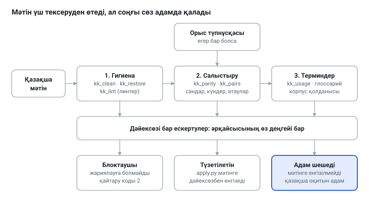
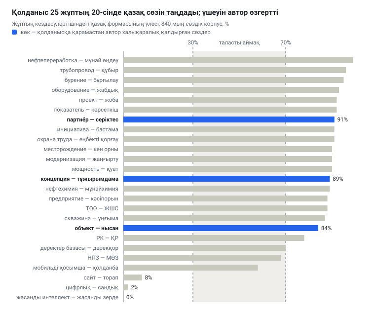

# Тек дұрыс көрінетін мәтін: қазақ тіліне неге өз корректоры керек

[Русский](longread.md) · [English](longread.en.md) · **Қазақша** · [← README](../README.kk.md)

*2026 жылғы 13 қазан*

> Бұл қазақша нұсқа — қазақ тілін жетік білетін адам әлі тексермеген аударма; түзетулер қабылданады.

kk-redkollegiya — қазақша мәтіннен көзге көрінбейтін қателерді іздейтін және аударманы орыс түпнұсқасымен салыстыратын шағын бағдарламалар жиынтығы. Бағдарламалар ештеңені үнсіз түзетпейді және автордың орнына жазбайды: тазалау журнал қалдырады, әр ескерту дәл дәйексөзімен келеді, ал шешім қазақша оқитын адамда қалады.

Жиынтықтың қажет болу себебі мынада: цифрлық әлемде қазақ мәтінінің бір ерекше қиындығы бар — сөз мінсіз көрінгенімен, басқа таңбалармен терілуі мүмкін. Көз оларды айырмайды, ал машина әрдайым айырады — сонда іздеу, сұрыптау, емле тексеру бұзылады. Төменде бұл қиындықтардың не екені, жиынтықтың олармен қалай күресетіні және нені істей алмайтыны жайлы айтылады.

## Бұл не

Бұл — қазақ тіліндегі мәтіндерді тексеретін ашық бағдарламалар жиынтығы: GPL-3.0 лицензиясы, бастапқы коды GitHub-та, сипаттамасы орыс, ағылшын және қазақ тілдерінде. Атауы екі бөліктен тұрады. «kk» — ISO 639-1 стандартындағы қазақ тілінің екі әріптік коды; ол локаль идентификаторларында кездеседі, мысалы Joomla тіл бумаларындағы kk-KZ. «redkollegiya» — жиынтық үлгі етіп алған жобаның аты.

Үлгі — redkollegiya, Claude Code үшін орыс мәтінін редакциялау жүйесі. Оның идеясы қарапайым: мәтінді бірнеше бөлек кезеңнен өткізеді, әрқайсысы өз түріндегі кемшіліктерді іздейді — техникалық, мағыналық, стильдік. Қазақ мәтініне мақсатты тілге арналған өз кезеңі керек; ол осында жасалған.

Жиынтықтың құрылымында үш негізгі идея бар.

- **Дәйексөзі бар ескерту.** Бағдарлама мәтінді қайта жазбайды. Ол былай хабарлайды: мынау үзінді, мынау оның ақауы, мынаған ауыстыруға болады. Түзетуді дәйексөз бойынша бөлек бағдарлама, `apply.py`, енгізеді, сондықтан көрші сөздерге тиіспейді.
- **Ескертулердің үш деңгейі.** «Блоктаушы» — жариялауға болмайды; «түзетілетін» — мәтінге бірден енгізіледі; «автордың қалауына қалдырылған» — мәтінге мүлде енгізілмейді. Таласты жағдай әрдайым адамға беріледі.
- **Соңғы сөз — қазақша оқитын адамда.** Бағдарлама өлшеуге болатынды ұстайды; талғам, мағына және әдеп адамдарда қалады.

## Неге керек: көзге көрінбейтін қателер

Қазақша мәтіндегі қателер екі түрлі болады. Біреулерін көз мүлде көрмейді — бұл әріптердің ақаулары. Басқаларын көз көреді, бірақ ұзақ салыстырусыз аңғара алмайды — бұл аударманың ақаулары. Оларды ретімен қарастырайық.

### Егіздер: өз сөзіндегі бөтен әріп

Юникод кодтау кестесінде әр таңбаның өз нөмірі бар. Кирилл «а» (U+0430) мен латын «a» (U+0061) — екі түрлі таңба, бірақ бірдей сызылған. Егер «қорықса» сөзінің соңғы екі әрпі латынмен терілсе, көз ештеңе байқамайды, ал іздеу, сұрыптау және емле тексеру бірден байқайды: олар үшін бұл басқа сөз.

> **Анықтама: Юникод және омоглиф.** «Юникод» (Unicode) атауы біртұтас әмбебап кодтауға меңзейді: «бірегей, біріккен, әмбебап». «Омоглиф» сөзі грек *homós* — «бірдей» және *glyphḗ* — «ойып жасалған таңба» сөздерінен құралған; ол сырт көрінісі басқа таңбадан айырылмайтын таңбаны білдіреді. Қауіпсіздікте дәл осындай егіздер мекенжайларды жалғандау үшін қолданылады: аты латын «а» әрпімен жазылған сайт шынайы көрінеді, ал мүлде басқа жаққа апарады.

Қазақ тілі үшін бұл әсіресе қауіпті: оның өз әріптері — ә, і, ө, ү, ұ, қ, ғ, ң, һ — көзге көрінетін егіздерге ие. Латын «i» қазақ «і» әрпіне, латын «ə» — «ә» әрпіне ұқсайды. Екінші жұп ең қауіптісі: Юникодта екі таңба да «schwa» деп аталады, бірақ олар әртүрлі таңбалар (U+0259 және U+04D9). «Қара сөздер» кітабының бір электрондық басылымында ауыстырылған «ә» әріптері 1 085 болып шықты.

> **Анықтама: schwa.** ə таңбасының атауы — «schwa» (орысша «шва» немесе «схва») — көне еврей жазуында қысқа анық емес дауысты дыбысты немесе дауыстының жоқтығын белгілеген белгінің атауынан шыққан. Қазір бұл сөзбен дыбыстың өзін де, оның таңбасын да атайды.

### Ескі кодтаулар: әріптер өз орнында жатпайды

Юникод кеңінен тарағанға дейін қазақ кітаптары мен газеттері арнайы қаріптермен терілді. Мұндай қаріп қ немесе ғ әрпін басқа бір таңбаның орнына — айталық, екпінді латын әрпінің орнына — салатын. Экранда бәрі оқылатын, ал файлда бөтен кодтар жататын. Осындай PDF-тен мәтінді алсаңыз — «мектеп» орнына «ìåêòåï» аласыз.

Жиынтық мұндай кодтауды өзі анықтап, әріптерді өз орнына қайтарады. Романның PDF-тен алынған үш томында қайта кодтаудан кейін сөздік сөздердің 77–79 пайызын таниды; одан бұрын мәтінді оқу мүмкін емес еді.

> **Анықтама: кодтау.** «Код» сөзі латын *codex* — «діңгек, жазуға арналған ағаш тақтайша», кейін «кітап, заңдар жинағы» сөзінен шыққан. Кодтау — нөмірлерге таңбалар сәйкес келетін кесте; ескі қазақ қаріптері бөтен кестелерді өзінше пайдаланған.

### Алмастырулар: әріптің орнында басқару таңбасы

Бұдан да нашар болады. PDF-тен мәтін алғанда кейбір қазақ әріптері көрінбейтін басқару таңбаларына немесе латын әріптеріне айналады. Бір кітапта мұндай таңбалар шамамен 760 болды. 602 сөздің түзетілуін сөздік растады, тағы 154 сөз контекст бойынша шығарылды. Сөздік растамағанның бәрін жиынтық болжам деп белгілеп, адамға береді.

### Қазақ әріптерінсіз терілген мәтін

Көпшілік қазақша орыс пернетақтасымен теріп, ерекше әріптерді қоймайды: «Қазақстан» орнына «Казакстан». Адамға түсінікті, іздеуге — жоқ. Таза мәтіндерде үйретілген символдық модель түзетуді ұсынады: өзі көрмеген кітаптарда сөздердің 90,1 пайызы бірінші талпыныста дұрыс шығады. Бірақ тұтас сөйлемдерде дұрыс ұсыныстар 69–77 пайыз, ал тиіспеген сөйлемдердің 4–13 пайызында жалған ұсыныстар кездеседі. Сондықтан ұсыныс ұсыныс күйінде қалады: оны үнсіз енгізуге болмайды.

### Калькалар: қазақ сөзіндегі орыс қаңқасы

Орыс тілінен аудару із қалдырады. Сөздер қазақша, ал айналым орысша: «сонымен қатар» («наряду с этим»), «аясында» («в рамках»), «атап өту» («отметить»), «жүзеге асыру» («осуществить»). 100 мың сөзге шаққанда мұндай айналымдар корпоративтік мәтіндерде 80-нен 120-ға дейін, кеңестік прозада екіден аз, классикада — бірде-бір рет кездеспейді. Бұл әрдайым қате емес: баспасөз хабарламасы жанрының өз тілі бар. Бірақ мұндай айналымдардың көптігі аударылған мәтінді әшкерелейді, жиынтық оны санайды, тыйым салмайды.

> **Анықтама: калька.** Сөз француз *calque* — «калька, яғни мөлдір қағаз арқылы алынған көшірме» сөзінен келген. Тіл білімінде калька деп бөтен тілден бөлшектеп аударылған, бөтен құрылымы сақталған айналымды атайды.

### Сандар мен атаулар аударма кезінде

Қазақ мәтіні аударма болғанда мынадай сұрақ туады: бәрі жетті ме. Екі тілді корпоративтік арнадағы «қазақша жазба — орысша жазба» 1 516 жұбында жиынтық сандарды, күндерді және латын атауларын салыстырды. Жұптардың 69,0 пайызында алшақтық табылмады. Сандар 26 жұпта (1,7 пайыз) ажырады; мұндай қателерді — «15,8» орнына «15,3» — жиынтық блоктаушы деп санайды. Жұптардың 11,5 пайызында латын атауы немесе қысқарту жоғалған.

Аудармадағы санды әдетте көзбен тексереді, бұл бағдарламамен салыстырудан ұзағырақ әрі сенімсізірек.

## Не үшін және кімге

Жиынтық қазақша мәтін туатын немесе цифрлық қолдардан өтетін, ал қате қымбатқа түсетін жерде қажет. Қос тілді ортада мұндай мәтін көбіне орыс тілінен аударма ретінде туады, сонда әріптер ақауларына салыстыру ақаулары қосылады.

- **Баспасөз қызметтері мен редакциялар.** Шығарар алдында мәтінді жиынтықтан өткізеді: ол көрінбейтін кемшіліктерді алады, сандар мен атауларды орыс түпнұсқасымен салыстырады және сіздің ортада қандай сөздерді қалай жазу қабылданғанын еске салады.
- **Аудармашылар.** Салыстыру жоғалған сандар мен атауларды ұстайды; глоссарий терминдер аудармасын бірізді етеді; айналымдарды санағыш аударманың орыс мәтініне тым ұқсайтын жерін көрсетеді.
- **Бағдарламашылар мен локализаторлар.** Joomla — ашық кодты сайт басқару жүйесі, оның интерфейсін `%s` сияқты толтырғыштары бар жолдар бумасымен аударады (толтырғыш — бағдарлама орнына санды немесе сөзді қоятын белгі). Жоғалған толтырғыш бетті бұзады. `ini` профилі мұндай жоғалтуды ұстап, қате коды қайтарады, сондықтан тексеруді сайтты құрастыруға қосуға болады.
- **Зерттеушілер мен кітапханалар.** Цифрланған кітаптар мен PDF-тен алынған мәтіндер кодтаумен және алмастырулармен бүлінген болады. Тазартылған корпус тілді зерттейтін немесе модельдерді тексеретін әркімге қажет: лас мәтіндерде қорытындылар да лас.

Қарапайым емле тексеру неге жеткіліксіз? Ол «сөз жоқ» дейді, бірақ неге екенін түсіндірмейді, ал белгісіз сөздер ағынында — есімдерде, терминдерде, жаңа сөздерде — мұндай хабар көміліп кетеді. Ол сандарды түпнұсқамен салыстырмайды және сізде жазу қалай қабылданғанын білмейді. Жиынтық сөздікті алмастырмайды, оған сүйеніп, қалғанын қосады.

## Қалай құрылған

Жиынтық бір конвейер бойына орналасқан жеті шағын бағдарламадан тұрады. Мәтін үш тексеру қабатынан өтеді; әр қабат дайын түзетулерді емес, ескертулерді береді. Содан кейін түзетілетіні мәтінге енгізіледі, ал таласты жағдай адамға беріледі.

**Бірінші қабат — гигиена.** Оның міндеті — мәтінді кез келген кейінгі жұмысқа жарамды ету. `kk_clean` кодтауды, алмастыруларды және егіздерді түзетіп, түзетілген көшірмені және әр түзетудің журналын жазады; `kk_restore` қазақ әріптерін қайтаруды ұсынады; `kk_lint` — линтер — басқа кемшіліктерді іздейді: латын «ə», бос жақшалар, жоғалған толтырғыштар, сөздікте жоқ сөздер.

> **Анықтама: линтер.** Сөз 1970 жылдардың соңында Bell Labs зертханаларында C тіліндегі бағдарламаларды тексеру үшін жазылған *lint* бағдарламасынан шыққан. Ағылшынша *lint* — «түк, мамық»: бағдарлама кодтан түктерді, киімді тазалағандай, тазалайды. Қазір линтер деп мәтіннен күмәнді жерлерді іздейтін, оны орындамайтын да, өзгертпейтін де кез келген бағдарламаны атайды.

**Екінші қабат — салыстыру.** Қазақ мәтінінің орыс түпнұсқасы болса, `kk_parity` сандарды, күндерді, санау сөздерін («мың», «млн», «млрд») және латын атауларын салыстырады. `kk_pairs` мұндай жұптарды екі тілді Telegram-арнаның экспортынан жинап, онда сөздердің қалай аударылатынын айта алады.

**Үшінші қабат — терминдер.** `kk_usage` корпус бойынша сөздің екі формасының қайсысын жазуды шешеді, ал глоссарий осы шешімдерді сақтайды. Толығырақ — келесі бөлімде.

> **Анықтама: корпус және глоссарий.** «Корпус» — латын *corpus*, «дене» сөзінен: тіл мамандары тілді зерттеу үшін іріктелген мәтіндер жиынтығын осылай атайды. «Глоссарий» грек *glôssa* — «тіл, түсіндіруді қажет ететін қараңғы сөз» сөзінен шыққан: алғашында көне қолжазбалардағы түсініксіз сөздерге берілген түсіндірмелер тізімін осылай атаған, қазір — қабылданған аудармасы бар терминдер тізімі.

**Түзетулерді енгізу.** Ескертулерді redkollegiya жобасындағы `apply.py` алады: ол әр дәйексөзді мәтіннен тауып, егер ол жалғыз болса, ауыстырады. Дәйексөзден басқа ештеңеге тиіспейді. Ескертулер деңгейлерін — блоктаушы, түзетілетін, автордың қалауына қалдырылған — ол өзі ажыратады.



Мұндай сызбаны былай оқу керек: солдан оңға қарай мәтін жүреді, әр қадамда одан ескертулер алынады, ал адам тек соңында пайда болады. Қазақша оқитын адам бүкіл мәтінді қайта көрмейді, тек оның сөзі ең қажет жерлердің қысқа тізімін көреді.

## Қолданыс, сән емес: жиынтық терминдермен қалай жұмыс істейді

Қазақ тіліне жаңа ұғымдарға сөз керек, және мұнда екі азғыру кездеседі. Біреуі — әрбір бөтен ұғымға өз сөзіңді ойлап табу, орыс тіліндегі «мокроступы» («калош» орнына) туралы әзіл сияқты. Екіншісі — бөтенді талғамсыз алу. Жиынтық екеуінің арасынан өзі таңдамайды: ол қолданысқа қарайды.

> **Анықтама: қолданыс және новояз.** «Қолданыс» (узус) — латын *usus*, «қолдану, әдет» сөзінен: тіл мамандары тірі сөйлеуде қалыптасқанды, ережемен белгіленгеннен ажырату үшін осылай атайды. «Новоязбен» күштеп енгізілген жаңа сөздерді атайды; бұл тіркестің өзі — Оруэллдің «1984» романындағы ағылшын *newspeak* сөзінің орысша калькасы.

Мұндай көзқарас жаңа емес. Шәкәрім «Үш анықта» дәл солай пайымдайды: ұғымның қазақша аты жоқ болса, дайынын алады — «атом» мен арабша «мадда» — және неге екенін ашық айтады.

Жиынтық ережесі: **корпус қолданысы — бірінші; халықаралық сөз — қолданыс үнсіз жерде ғана.** «Халықаралық форма — қазақ формасы» әр жұбы үшін бағдарлама қазақша мәтіндегі кездесулерді санайды. Егер бір форма кездесулердің кемінде 70 пайызын алса (он және одан көп кездесуде), сол жеңеді. Егер кездесу онға жетпесе, қолданыс үнсіз, және халықаралық форма алынады. Егер үлестер 30 мен 70 пайыздың арасында жатса, жағдай таласты, шешімді автор қабылдайды.

840 мың сөздік корпустан мысалдар: «цифрлық» 98 пайыз жағдайда кездеседі, ал «сандық» — 2 пайыз; «жасанды интеллект» — 225 рет, «жасанды зерде» — бірде-бір рет. Тірі сөйлеу қазақ сөзін таңдаған жерде жиынтық соған ілеседі: «жоба» «проект» формасына қарсы кездесулердің 92 пайызын алады.

Ереже адамға қызмет етеді, керісінше емес. Автор өз шешімін бекіте алады, ол қолданыстың үстінен тұрады. Төрт сөз халықаралық қалдырылған:

- **объект және субъект** — аударылмайды: бұл халықаралық терминдер. Корпус «нысанды» артық көреді (84 пайыз), бірақ автордың шешімі маңыздырақ;
- **концепция** — халықаралық сөз болып қалады. «Тұжырымдама» синоним ретінде рұқсат етіледі, бірақ міндетті емес: «концепция» негізгі ұғымды, түп негізде жатқанды білдіреді;
- **партнер** — аударылмайды: сөзде ресми, іскерлік қатынас реңкі бар. «Серіктес» мағынасы жағынан әріптеске, жолдасқа, кейде досқа жақынырақ; жолдаспен жан сырын айтуға болады, партнермен — болмайды.



Көк жолақтар — корпус қазақ формасын жақтаған, бірақ автор халықаралығын қалдырған сөздер. Таласты аймақта екі жұп жатыр: «НПЗ» — «МӨЗ» және «мобильді қосымша» — «қолданба»; олар бойынша автор «МӨЗ» мен «қолданбаны» таңдады. Нөлге жақын үш жұп — тірі сөйлеудің өзі халықаралық сөзді таңдаған жерлер: «цифрлық», «сайт», «жасанды интеллект».

Жалпы ескертпе де бар. Корпус қолданысы — онда жазғандардың қолданысы, ал олардың арасында аудармашылар көп, сондықтан ол калькаларды да бекітіп жіберуі мүмкін. Сондықтан жиынтық шешімдерді ұсыныс ретінде қолданады: жеңілген форма тіл иелерінде тіршілік етеді және атауларда тұр, сондықтан оны үнсіз ауыстыруға болмайды.

## Нені өлшедік

Барлық өлшемдер автордың жеке корпустарында жасалды — кітаптар, газеттер және екі тілді корпоративтік арна; мәтіндердің өзі жарияланбайды. Сандар жиынтықтың осы мәтіндерде өзін қалай көрсеткенін білдіреді, кез келген басқа мәтінде де солай болады деп уәде бермейді.

| Нені тексерді | Нәтиже | Неде |
| --- | --- | --- |
| Ескі қаріптерді қайта кодтау | сөздік сөздердің 77–79 пайызын таниды; бұған дейін мәтін оқылмайтын | PDF-тен алынған романның үш томы |
| Әріптерді алмастыру | 602 сөзді сөздік растады, 154 сөз контекст бойынша шығарылды | PDF кітап, шамамен 760 таңба |
| Қазақ әріптерін қайтару | сөздердің 90,1 пайызы бірінші талпыныста дұрыс; сөйлемдерде 69–77 пайыз; тиіспеген сөйлемдердің 4–13 пайызында жалған ұсыныс | модель көрмеген кітаптар |
| Түпнұсқамен салыстыру | жұптардың 69,0 пайызында алшақтық жоқ; сандар 1,7 пайызында ажырайды | 1 516 жұп «қазақша жазба — орысша жазба» |
| Терминдер саясаты | 25 жұптың 20-сі қолданыс бойынша шешілген, 5-еуі автор шешімімен бекітілген | шамамен 840 мың сөздік корпус |

Бұл өлшемдер тәуелсіз тексеруден өткен жоқ. Басты жетіспейтін өлшем — қазақ тілін жетік білетін адам белгілеген сөйлемдердің эталондық жиынында — әлі алда; ол туралы төменде.

## Жиынтық нені істемейді

Шектерді тура атау керек.

- **Жазбайды және қайта жазбайды.** Жиынтық іздейді және ұсынады; дәйексөз бойынша бөлек бағдарлама түзетеді, ал таласты жағдайды адам шешеді.
- **Мағына мен стильді бағаламайды.** Мағына (калькалар, сөз тәртібі, меңгеру), машиналық жазу іздері және емле бойынша кезеңдер әлі жазылмаған. Әзірге олардың орнын қазақша оқитын адам басады.
- **Латын жазуына тиіспейді.** Жиынтық қазақ тілінің кирилл жазуына арналған; мәтіндегі латын сөздері өз қалпында қалады.
- **Ескі сөздікке сүйенеді.** Hunspell — емле сөздік тексеруінің қозғалтқышы, оны LibreOffice, Firefox және басқа да көптеген бағдарламалар пайдаланады; ол морфологиясы күрделі тілдерге арналған, ал қазақ тілі дәл сондай. Бірақ hunspell-kk сөздігінің өзі — 2000 жылдардың соңындағы жоба, шамамен 54 мың түбір. Шағын таңдамада ол дұрыс сөздердің 14 пайызын белгісіз деп санады, бірақ әдейі бүлдірілген 11 сөздің бәрін де тапты. Оның сөзі — күдік, үкім емес.
- **Ұсынады, бірақ таңбайды.** Қазақ әріптерін қайтару және глоссарий бойынша ауыстырулар ұсыныс ретінде беріледі: жалған іске қосылулар болады.
- **Адамды алмастырмайды.** Жиынтықтың тәуелсіз тексеруі жоқ, қазақ тілін жетік білетін адам белгілеген сөйлемдердің эталондық жиыны әлі де жоқ.

## Әрі қарай

Бірінші қабат — скрипттер — дайын; алда үш жұмыс бар.

**Тіл моделі бар өту кезеңдері.** Төрт кезең әлі жазылған жоқ: мағына бойынша (калькалар, сөз тәртібі, меңгеру), машиналық жазу іздері бойынша, емле бойынша және терминдер бойынша. Мұнда қазақша оқитын модель керек, ал мәселе — қайсысы.

**Эталондық жиын.** Жұмыс мәтіндерінен 150–300 сөйлем керек; олардағы дұрыс-бұрысты тіл иесі белгілейді. Онсыз шектерді реттеуге де, модельдерді шын салыстыруға да болмайды; бұл — басты жетіспейтін буын.

**Модельдерді таңдау.** [ISSAI](https://issai.nu.edu.kz/kazllm/) — Назарбаев Университетінің зияткерлік жүйелер және жасанды интеллект институты — бетінде қазақ тілді модельдердің екі буыны орналасқан. KazLLM 1.0 (2024 жылғы желтоқсан) [CC BY-NC](https://huggingface.co/issai/LLama-3.1-KazLLM-1.0-8B) лицензиясымен шығарылған, яғни коммерциялық емес пайдалануға арналған, оған Llama 3.1 үшін Meta шарттары қосылған; коммерциялық жұмыс үшін авторлардың жеке рұқсаты қажет. Жаңа [Qwen3.5 Kazakh](https://huggingface.co/issai/Qwen3.5-9B-Kazakh) модельдері (4B, 9B және 35B-A3B) Apache 2.0 бойынша шығарылған, ол коммерциялық пайдалануға да мүмкіндік береді. Қазақша білім тесттерінде олар бастапқы Qwen3.5-тен озады: мысалы, KazMMLU-да 9B моделі 77,0-ге қарсы 83,1 береді. Мәтінді түзету бойынша тесттер олардың екеуінде де жоқ, сондықтан біздің іске жарамдылығын эталондық жиындағы өлшем ғана көрсетеді. Ол әзірге жүргізілген жоқ.

Қалған жоспарлар қарапайымырақ: типограф-скрипт, морфологиялық талдағышты қосу, стиль профильдері — «кеңестік норма», «классикалық», «ресми», «пресс-релиз».

## Қалай байқап көру

Репозиторий — [bsakhanov/kk-redkollegiya](https://github.com/bsakhanov/kk-redkollegiya). Сипаттама мен пайдалану нұсқаулығы орыс, ағылшын және қазақ тілдерінде бар: [README](../README.kk.md) және [нұсқаулық](USAGE.kk.md). Орнату — төрт команда:

```bash
git clone https://github.com/bsakhanov/kk-redkollegiya.git
cd kk-redkollegiya
pip install -r requirements.txt
sh tests/run_tests.sh
```

Python 3.8 немесе одан кейінгі нұсқасы қажет. hunspell-kk сөздігі бөлек командамен жүктеледі, ал `apply.py` redkollegiya жобасынан алынады; екі қадам да нұсқаулықта сипатталған.

Лицензия — GPL-3.0-or-later. Нұсқалар семантикалық нұсқалау ережелері бойынша нөмірленеді; әзірге бұл 0.x, және командалық жол интерфейстері өзгеруі мүмкін.

Қазақша оқитын кез келген адам көмектесе алады: құжаттаманы тексеру (оның қазақша нұсқасы — тіл иесі әлі тексермеген аударма), қорғалған мәтіндерсіз қате үлгілерін жіберу, глоссарийді тексеру. Ескертулер репозиторийдің [Issues](https://github.com/bsakhanov/kk-redkollegiya/issues) бөлімінде қабылданады.

## Пайдаланылған дереккөздер тізімі

1. [kk-redkollegiya](https://github.com/bsakhanov/kk-redkollegiya) — репозиторий, README және үш тілдегі пайдалану нұсқаулығы.
2. [redkollegiya](https://github.com/beaverbeard/redkollegiya) — жиынтыққа үлгі болған орыс мәтінін редакциялау жүйесі.
3. [ISSAI KAZ-LLM](https://issai.nu.edu.kz/kazllm/) — Назарбаев Университетінің зияткерлік жүйелер және жасанды интеллект институтының KazLLM 1.0 моделі туралы беті.
4. [issai/LLama-3.1-KazLLM-1.0-8B](https://huggingface.co/issai/LLama-3.1-KazLLM-1.0-8B) — модель карточкасы: лицензия, пайдалану шарттары, бағалар.
5. [issai/Qwen3.5-9B-Kazakh](https://huggingface.co/issai/Qwen3.5-9B-Kazakh) және [issai/Qwen3.5-35B-A3B-Kazakh](https://huggingface.co/issai/Qwen3.5-35B-A3B-Kazakh) — жаңа модельдер карточкалары: әдіс, лицензия, бағалар.

«Неге керек» және «Нені өлшедік» бөлімдеріндегі өлшемдер автордың жеке корпустарында жасалды; мәтіндердің өзі жарияланбайды. Этимологиялық анықтамалар жалпыға мәлім мәліметтер бойынша берілген, сөздіктерге сілтемесіз.
