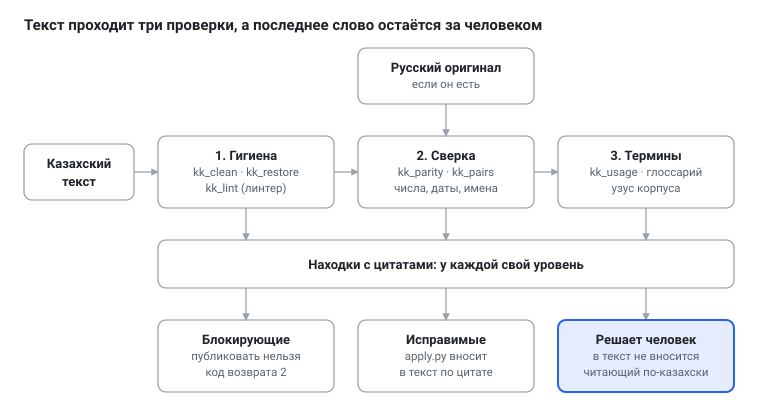
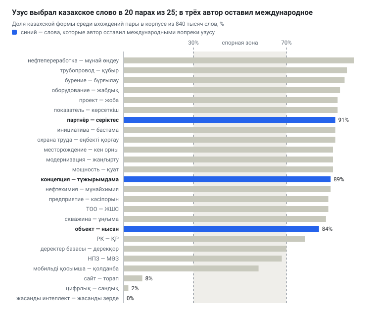

# Текст, который только выглядит правильно: зачем казахскому языку свой корректор

**Русский** · [English](longread.en.md) · [Қазақша](longread.kk.md) · [← README](../README.md)

*13 октября 2026 года*

kk-redkollegiya — набор небольших программ, который ищет в казахском тексте ошибки, невидимые глазу, и сличает перевод с русским оригиналом. Программы ничего не правят молча и не пишут за автора: чистка оставляет журнал, каждая находка приходит с точной цитатой, а решение остаётся за человеком, читающим по-казахски.

Нужен набор потому, что у казахского текста в цифровом мире есть особая беда: слово может выглядеть безупречно и быть набрано не теми знаками. Глаз их не отличит, машина отличит всегда — и тогда ломаются поиск, сортировка, проверка орфографии. Ниже — о том, что это за беды, как набор с ними справляется и чего он не умеет.

## Что это такое

Это открытый набор программ для проверки текстов на казахском языке: лицензия GPL-3.0, исходный код на GitHub, описание на русском, английском и казахском. Название складывается из двух частей. «kk» — двухбуквенный код казахского языка в стандарте ISO 639–1; он встречается в идентификаторах локали, например kk-KZ в языковых пакетах Joomla. «redkollegiya» — имя проекта, по образцу которого набор сделан.

Образец — redkollegiya, система редактуры русского текста для Claude Code. Её замысел прост: тексту дают пройти несколько раздельных проходов, и каждый ищет свой род изъянов — технические, смысловые, стилистические. Для казахского текста нужен собственный проход по языку-цели; он здесь и построен.

В устройстве набора три основные мысли.

- **Находка с цитатой.** Программа не переписывает текст. Она сообщает: вот фрагмент, вот чем он плох, вот чем его можно заменить. Правку вносит отдельная программа, `apply.py`, по дословной цитате, и потому не задевает соседние слова.
- **Три уровня находок.** «Блокирующая» — публиковать нельзя; «исправимая» — вносится в текст сразу; «на усмотрение автора» — в текст не вносится вовсе. Спорное всегда уходит к человеку.
- **Последнее слово — за читающим по-казахски.** Программа ловит то, что можно измерить; вкус, смысл и такт остаются людям.

## Зачем это нужно: ошибки, которых не видно глазом

Ошибки в казахском тексте бывают двух родов. Одни глаз не видит вовсе — это беды букв. Другие видит, но не уловит без долгой сверки — это беды перевода. Разберём их по порядку.

### Двойники: чужая буква в своём слове

В кодовой таблице Юникод у каждого знака свой номер. Кириллическая «а» (U+0430) и латинская «a» (U+0061) — два разных знака, хотя нарисованы одинаково. Если в слове «қорықса» две последние буквы набраны латиницей, глаз ничего не заметит, а поиск, сортировка и проверка орфографии заметят сразу: для них это другое слово.

> **Справка: Юникод и омоглиф.** Название «Юникод» (Unicode) задумано как намёк на единую универсальную кодировку: «уникальный, единый, универсальный». Слово «омоглиф» собрано из греческих *homós* — «одинаковый» и *glyphḗ* — «резьба, вырезанный знак»; так называют знак, неотличимый на вид от другого. В безопасности те же двойники служат для подделки адресов: сайт с латинской «а» в имени выглядит настоящим, а ведёт совсем в другое место.

Казахскому языку это грозит особенно: его собственные буквы — ә, і, ө, ү, ұ, қ, ғ, ң, һ — имеют зримых близнецов. Латинская «i» похожа на казахскую «і», латинская «ə» — на «ә». Вторая пара коварнее всех: оба знака в Юникоде зовутся «schwa», но это разные знаки (U+0259 и U+04D9). В одном электронном издании «Қара сөздер» Абая подменённых «ә» оказалось 1 085.

> **Справка: схва.** Название знака ə — «schwa» (по-русски «шва» или «схва») — восходит к древнееврейскому названию значка, которым в письме обозначали краткий неясный гласный или отсутствие гласного. Теперь так зовут и сам звук, и его знак.

### Старые кодировки: буквы лежат не на своих местах

Прежде чем Юникод вошёл в обиход, казахские книги и газеты набирали особыми шрифтами. Такой шрифт рисовал қ или ғ на месте какого-нибудь другого знака — скажем, латинской буквы с акцентом. На экране всё читалось, а в файле лежали чужие коды. Достаньте текст из такого PDF — и вместо «мектеп» получите «ìåêòåï».

Набор определяет такую кодировку сам и возвращает буквы на места. На трёх томах романа, извлечённых из PDF, после перекодировки словарь узнаёт 77–79% слов; до неё текст нечитаем.

> **Справка: кодировка.** Слово «код» восходит к латинскому *codex* — «ствол, деревянная дощечка для письма», затем «книга, свод законов». Кодировка есть таблица, по которой номерам отвечают знаки; старые казахские шрифты пользовались чужими таблицами по-своему.

### Подмены: знак управления вместо буквы

Бывает хуже. При извлечении текста из PDF иные казахские буквы превращаются в невидимые управляющие знаки или в латинские буквы. В одной из книг таких знаков набралось около 760. Для 602 слов исправление подтвердил словарь, ещё 154 выведены по контексту. Всё, чего словарь не подтвердил, набор помечает как догадку и отдаёт человеку.

### Набор без казахских букв

Многие печатают по-казахски на русской раскладке и не ставят особых букв: «Казакстан» вместо «Қазақстан». Человеку понятно, поиску — нет. Символьная модель, обученная на чистых текстах, предлагает исправление: на книгах, которых она не видела, с первой попытки верно 90,1% слов. Но на целых предложениях верных подсказок 69–77%, а ложные случаются в 4–13% нетронутых предложений. Поэтому подсказка остаётся подсказкой: вносить её молча нельзя.

### Кальки: русский каркас в казахской речи

Перевод с русского оставляет следы. Слова казахские, а оборот русский: «сонымен қатар» («наряду с этим»), «аясында» («в рамках»), «атап өту» («отметить»), «жүзеге асыру» («осуществить»). На 100 тысяч слов такие обороты встречаются в корпоративных текстах от 80 до 120 раз, в советской прозе — менее двух, в классике — ни разу. Это не всегда ошибка: у жанра пресс-релиза свой язык. Но избыток таких оборотов выдаёт переведённый текст, и набор его считает, а не запрещает.

> **Справка: калька.** Слово пришло из французского *calque* — «копия, снятая через кальку, то есть прозрачную бумагу». В языкознании калькой зовут оборот, переведённый с чужого языка по частям, с сохранением чужого построения.

### Числа и имена при переводе

Когда казахский текст — перевод, встаёт вопрос: всё ли дошло. На 1 516 парах «казахский пост — русский пост» из двуязычного корпоративного канала набор сверил числа, даты и латинские имена. Расхождений не нашлось в 69,0% пар. Числа разошлись в 26 парах (1,7%); ошибки такого рода — «15,3» вместо «15,8» — набор считает блокирующими. В 11,5% пар потерялось латинское имя или сокращение.

Цифру в переводе обычно проверяют глазами, и это дольше и ненадёжнее, чем сличение программой.

## Для чего и кому

Набор нужен там, где казахский текст рождается или проходит через цифровые руки, а ошибка обходится дорого. В двуязычной среде такой текст нередко рождается как перевод с русского, и тогда к бедам букв прибавляются беды сличения.

- **Пресс-службы и редакции.** Перед выпуском текст прогоняют через набор: он снимает невидимые изъяны, сверяет числа и имена с русским оригиналом и напоминает, какие слова в вашем кругу принято писать так, а не иначе.
- **Переводчики.** Сверка ловит потерянные цифры и имена; глоссарий держит единым перевод терминов; счётчик оборотов показывает, где перевод слишком похож на русский текст.
- **Разработчики и локализаторы.** Joomla — система управления сайтами с открытым кодом, и её интерфейс переводят пакетами строк с заполнителями вроде `%s` (заполнитель — метка, на место которой программа подставит число или слово). Потерянный заполнитель ломает страницу. Профиль `ini` ловит такие потери и возвращает код ошибки, так что проверку можно поставить в сборку сайта.
- **Исследователи и библиотеки.** Оцифрованные книги и выгрузки из PDF бывают испорчены кодировкой и подменами. Очищенный корпус нужен всякому, кто изучает язык или проверяет модели: на грязных текстах и выводы грязные.

Почему недостаточно обычной проверки орфографии? Она говорит «слова нет», но не объясняет почему, а в потоке неизвестных слов — имён, терминов, новых слов — такое сообщение тонет. Она не сверяет числа с оригиналом и ничего не знает о том, как принято писать у вас. Набор не заменяет словарь, а опирается на него и добавляет остальное.

## Как это устроено

Набор состоит из семи небольших программ, расставленных вдоль одного конвейера. Текст проходит три слоя проверки; каждый слой отдаёт находки, а не готовые правки. Затем исправимое вносится в текст, а спорное уходит человеку.

**Первый слой — гигиена (Алтынсарин).** Его задача — сделать текст пригодным для любой дальнейшей работы. `kk_clean` чинит кодировку, подмены и двойники, записывая исправленную копию и журнал каждой правки; `kk_restore` предлагает вернуть казахские буквы; `kk_lint` — линтер — ищет прочие изъяны: латинскую «ə», пустые скобки, потерянные заполнители, слова вне словаря.

> **Справка: линтер.** Слово идёт от программы *lint*, написанной в конце 1970-х в лабораториях Bell Labs для проверки программ на языке C. По-английски *lint* — «пух, ворс»: программа снимает с кода ворсинки, как чистят одежду. Теперь линтером зовут всякую программу, которая ищет в тексте подозрительные места, не исполняя и не переделывая его.

**Второй слой — сверка (Валиханов).** Если у казахского текста есть русский оригинал, `kk_parity` сличает числа, даты, счётные слова («мың», «млн», «млрд») и латинские имена. `kk_pairs` умеет собрать такие пары из выгрузки двуязычного Telegram-канала и подсказать, как в нём переводят слова.

**Третий слой — термины (Шакарим).** `kk_usage` по корпусу решает, какую из двух форм слова писать, а глоссарий хранит эти решения. Подробнее — в следующем разделе.

> **Справка: корпус и глоссарий.** «Корпус» — от латинского *corpus*, «тело»: так языковеды зовут собрание текстов, подобранное для изучения языка. «Глоссарий» восходит к греческому *glôssa* — «язык, тёмное слово, требующее пояснения»: сперва так назвали список разъяснений к непонятным словам в старых рукописях, теперь — список терминов с принятым переводом.

**Внесение правок.** Находки получает `apply.py` из проекта redkollegiya: он находит каждую цитату в тексте и, если она единственна, заменяет её. Ничего, кроме цитаты, он не трогает. Уровни находок — блокирующие, исправимые, на усмотрение автора — он различает сам.

**Имена слоёв.** В русской Редколлегии слои носят имена тех, чьё слово в своём ремесле служит мерой: Чуковского, Аграновского, Розенталя, Мильчина. Тот же обычай принят и здесь. Гигиена зовётся Алтынсарин: он составил «Киргизскую хрестоматию» 1879 года (киргизами тогда называли казахов), одну из первых книг, напечатанных по-казахски кириллицей. Сверка с оригиналом — Валиханов, учёный, писавший о казахах по-русски: живой мост между двумя текстами. Термины — Шакарим, который в «Үш анық» берёт «атом» и «мадда», когда казахского слова нет; это и есть наша политика. У будущих слоёв имена тоже есть: смысл и живая речь — Ауэзов, чей язык в «Абай жолы» служит образцом казахской прозы; норма — Байтурсынов, основоположник казахского языкознания; следы машинного письма — «Слопотрон-kk», название-шутка, унаследованная от русской семьи.



Как читать такую схему: слева направо идёт текст, на каждом шаге из него вынимают находки, и лишь в конце появляется человек. Читающий по-казахски видит не весь текст заново, а короткий список мест, где его слово нужнее всего.

## Узус, а не мода: как набор обращается с терминами

Казахскому языку нужны слова для нового, и здесь сходятся два соблазна. Один — придумать своё слово для всякого чужого понятия, как в русской шутке про «мокроступы» вместо «калош». Другой — брать чужое без разбора. Набор не выбирает между ними сам: он смотрит на узус.

> **Справка: узус и новояз.** «Узус» — от латинского *usus*, «употребление, обычай»: так языковеды зовут то, что сложилось в живой речи, в отличие от предписанного правилом. «Новоязом» зовут навязанные новые слова; сам оборот есть русская калька английского *newspeak* из романа Оруэлла «1984».

Такой взгляд не нов. Шакарим в «Үш анық» («Три истины») рассуждает так же: у понятия нет казахского названия — он берёт готовое, «атом» и арабское «мадда», и прямо говорит, почему.

Правило набора: **узус корпуса — первым; международное слово — только там, где узус молчит.** Для каждой пары «международная форма — казахская форма» программа считает вхождения в казахском тексте. Если одна форма занимает не меньше 70% вхождений (при десяти и больше), побеждает она. Если вхождений меньше десяти, узус молчит, и берётся международная форма. Если доли лежат между 30 и 70%, случай спорный, и решает автор.

Примеры из корпуса в 840 тысяч слов: «цифрлық» встречается в 98% случаев, а «сандық» — в 2%; «жасанды интеллект» — 225 раз, «жасанды зерде» — ни разу. Там, где живая речь выбрала казахское слово, набор следует ей: «жоба» занимает 92% вхождений против «проект».

Правило служит человеку, а не наоборот. Автор может закрепить своё решение, и оно встаёт поверх узуса. Четыре слова оставлены международными:

- **объект и субъект** — не переводятся: это международные термины. Корпус предпочитает «нысан» (84%), но решение автора важнее;
- **концепция** — остаётся международным словом. «Тұжырымдама» допустимо как синоним, но не обязательно: «концепция» означает основное понятие, то, что лежит в основе;
- **партнёр** — не переводится: у слова оттенок формальных, деловых отношений. «Серіктес» ближе к «товарищу» — к коллеге, порой к другу; с товарищем можно поговорить по душам, с партнёром — нет.

Есть и пара, где автор выбрал не международное слово, а устоявшееся словосочетание: для «приложение» основной стала «мобильді қосымша», а «қолданба» допустимо как синоним. В корпусе «қолданба» стоит чаще (21 против 15), но решение автора стоит поверх узуса.



Синие полосы — слова, у которых корпус стоял за казахскую форму, но автор оставил международную. В спорной зоне лежат две пары, «НПЗ» — «МӨЗ» и «мобильді қосымша» — «қолданба»; по ним автор выбрал «МӨЗ» и «мобильді қосымша». Три пары у нуля — те, где живая речь сама выбрала международное слово: «цифрлық», «сайт», «жасанды интеллект».

Есть и общая оговорка. Узус корпуса — это узус тех, кто в нём писал, а среди них много переводчиков, и он способен закреплять кальки. Потому решения набор применяет как предложения: проигравшая форма живёт у носителей и стоит в названиях, так что молча заменять её нельзя.

## Что уже измерено

Все замеры сделаны на частных корпусах автора — книгах, газетах и двуязычном корпоративном канале; сами тексты не публикуются. Цифры показывают, как набор вёл себя на этих текстах, и не обещают того же на любых других.

| Что проверяли | Результат | На чём |
| --- | --- | --- |
| Перекодировка старых шрифтов | словарь узнаёт 77–79% слов; до неё текст нечитаем | три тома романа из PDF |
| Подмены букв | 602 слова подтверждены словарём, 154 выведены по контексту | PDF-книга, около 760 знаков |
| Возврат казахских букв | 90,1% слов верно с первой попытки; на предложениях 69–77%; ложные подсказки в 4–13% нетронутых предложений | книги, которых модель не видела |
| Сверка с оригиналом | расхождений нет в 69,0% пар; числа расходятся в 1,7% | 1 516 пар «казахский пост — русский пост» |
| Политика терминов | из первых 25 пар 20 решены по узусу, 5 закреплены решением автора | корпус около 840 тысяч слов |
| Глоссарий | 71 запись на 63 пары: 42 решены по узусу, 26 закреплены решением автора, 3 без статуса | корпус около 840 тысяч слов |

Независимой проверки эти замеры не проходили. Главный недостающий замер — на эталонном наборе предложений с пометками носителя языка — ещё впереди; о нём ниже.

## Чего набор не делает

Границы стоит назвать прямо.

- **Не пишет и не переписывает.** Набор ищет и предлагает; правит по цитате отдельная программа, а спорное решает человек.
- **Не судит смысл и стиль.** Проходы по смыслу (кальки, порядок слов, управление), по следам машинного письма и по орфографии ещё не написаны. Пока их место занимает читающий по-казахски.
- **Не трогает латиницу.** Набор рассчитан на кириллическое письмо казахского языка; латинские слова в тексте остаются как есть.
- **Опирается на старый словарь.** Hunspell — движок словарной проверки, которым пользуются LibreOffice, Firefox и многие другие программы; он создан для языков со сложным словоизменением, и казахский как раз таков. Но сам словарь hunspell-kk — проект конца 2000-х, около 54 тысяч основ. На малой выборке он счёл неизвестными 14% верных слов, зато поймал все 11 нарочно испорченных. Его слово — подозрение, а не приговор.
- **Подсказывает, но не навязывает.** Возврат казахских букв и замены по глоссарию идут как предложения: ложные срабатывания бывают.
- **Не заменяет человека.** Независимой проверки у набора нет, эталонного набора предложений с пометками носителя языка пока нет тоже.

## Что дальше

Первый слой — скрипты — готов; впереди три работы.

**Проходы с языковой моделью.** Четыре прохода ещё не написаны: по смыслу (кальки, порядок слов, управление), по следам машинного письма, по орфографии и по терминам. Здесь нужна модель, которая читает по-казахски, и вопрос в том, какая.

**Эталонный набор.** Нужны 150–300 предложений из рабочих текстов, где носитель языка пометил, что верно, а что нет. Без него нельзя ни настроить пороги, ни честно сравнить модели; это главное недостающее звено.

**Выбор моделей.** На странице [ISSAI](https://issai.nu.edu.kz/kazllm/) — института Назарбаев Университета — выложены казахские модели двух поколений. KazLLM 1.0 (декабрь 2024) выпущена под лицензией [CC BY-NC](https://huggingface.co/issai/LLama-3.1-KazLLM-1.0-8B), то есть для некоммерческого использования, и к ней добавлены условия Meta для Llama 3.1; для коммерческой работы нужно отдельное разрешение авторов. Новые модели [Qwen3.5 Kazakh](https://huggingface.co/issai/Qwen3.5-9B-Kazakh) (4B, 9B и 35B-A3B) выпущены под Apache 2.0, который допускает и коммерческое использование. На казахских тестах знаний они опережают исходный Qwen3.5: например, на KazMMLU модель 9B даёт 83,1 против 77,0. Тестов на правку текста нет ни у тех, ни у других, поэтому пригодность для нашего дела покажет только замер на эталонном наборе. Он пока не проведён.

Остальные планы скромнее: скрипт-типограф, подключение морфологического анализатора, профили стиля — «советская норма», «классический», «официальный», «пресс-релиз».

## Как попробовать

Репозиторий — [bsakhanov/kk-redkollegiya](https://github.com/bsakhanov/kk-redkollegiya). Описание и руководство пользователя есть на русском, английском и казахском: [README](../README.md) и [руководство](USAGE.md). Установка — четыре команды:

```bash
git clone https://github.com/bsakhanov/kk-redkollegiya.git
cd kk-redkollegiya
pip install -r requirements.txt
sh tests/run_tests.sh
```

Нужен Python 3.8 или новее. Словарь hunspell-kk скачивается отдельной командой, а `apply.py` берётся из проекта redkollegiya; оба шага описаны в руководстве.

Лицензия — GPL-3.0-or-later. Версии нумеруются по правилам семантического версионирования; пока это 0.x, и интерфейсы командной строки могут меняться.

Помочь может всякий, кто читает по-казахски: вычитать документацию (её казахская версия — перевод, ещё не проверенный носителем языка), прислать образцы ошибок без охраняемых текстов, проверить глоссарий. Замечания принимаются в разделе [Issues](https://github.com/bsakhanov/kk-redkollegiya/issues) репозитория.

## Список использованных источников

1. [kk-redkollegiya](https://github.com/bsakhanov/kk-redkollegiya) — репозиторий, README и руководство пользователя на трёх языках.
2. [redkollegiya](https://github.com/beaverbeard/redkollegiya) — система редактуры русского текста, по образцу которой сделан набор.
3. [ISSAI KAZ-LLM](https://issai.nu.edu.kz/kazllm/) — страница института интеллектуальных систем и искусственного интеллекта Назарбаев Университета о модели KazLLM 1.0.
4. [issai/LLama-3.1-KazLLM-1.0–8B](https://huggingface.co/issai/LLama-3.1-KazLLM-1.0-8B) — карточка модели: лицензия, условия использования, оценки.
5. [issai/Qwen3.5–9B-Kazakh](https://huggingface.co/issai/Qwen3.5-9B-Kazakh) и [issai/Qwen3.5–35B-A3B-Kazakh](https://huggingface.co/issai/Qwen3.5-35B-A3B-Kazakh) — карточки новых моделей: метод, лицензия, оценки.

Замеры в разделах «Зачем это нужно» и «Что уже измерено» сделаны на частных корпусах автора; сами тексты не публикуются. Этимологические справки приведены по общеизвестным сведениям, без ссылок на словари.
